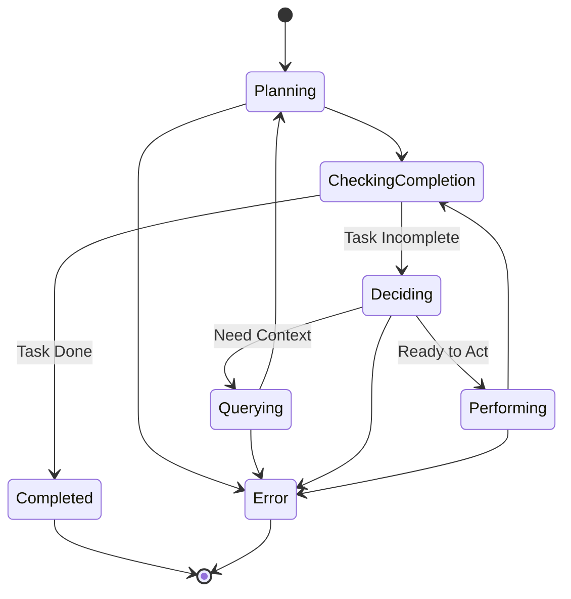

# Agent Control Flow

See [ARCHITECTURE.md](ARCHITECTURE.md) for the harness control flow diagram.

## What an agent should NOT do

- Lower the `target:` value in `codecov.yml`. The guard rejects decreases; admin bypass is the only path.
- Add entries to `ignore:` in `codecov.yml`. The guard counts entries (block- and flow-style) and rejects growth.
- Replace a numeric `target:` with `auto` or remove it. The guard rejects loss of a numeric floor.
- Edit, rename, or delete `.github/workflows/codecov-guard.yml`, `.github/CODEOWNERS`, or other files in `.github/workflows/**` to circumvent the guard.
- Write to a **protected path**. Nanna does not modify the configuration of the repository it works in or its own configuration directory. The fixed set that ships with the executable (`harness::protected::PROTECTED_PATTERNS`, matched case-insensitively) is `.nanna/**` (agent identities, `deploy.toml`, availability windows, and the repository's own `.nanna/protected.toml`), `**/.nanna/**` (any nested `.nanna/` directory), `.git/**`, `.github/workflows/**`, `.github/CODEOWNERS`, `CODEOWNERS`, `docs/CODEOWNERS`, `codecov.yml`, `windows.toml`, `tarpaulin.toml`, `deny.toml`, `flake.nix`, `flake.lock`, `.github/rulesets/**`, `.githooks/**`, `.cargo/**`, `.devcontainer/**`, `AGENTS.md`, `.gitattributes`, `.gitmodules`, `.github/**` (every file under `.github`, including actions and `dependabot.yml`), `.cargo-husky/**`, `.envrc`, `.config/**`, `.claude/**`, `nix/**` and `CLAUDE.md`, plus Nanna's own configuration directory (`$NANNA_CONFIG_DIR`, else `$XDG_CONFIG_HOME/nanna`, else `~/.config/nanna`). A repository may protect more by declaring extra patterns in `.nanna/protected.toml` (`extra = ["path", "dir/**"]`; each entry is a normalised relative literal path, optionally ending in `/**`). The declaration only adds: it cannot remove a shipped pattern or the configuration-directory rule, unknown keys are rejected, and a malformed, unreadable or non-regular file makes the task refuse to start (a missing file declares nothing, so a checkout without it has only the shipped set); the file may be at most 65536 bytes and declare at most 256 patterns, and a declared directory protects its whole tree only when written with a trailing `/**` (a bare directory path protects just that one path). It is read from the base checkout on the host before the task's worktree is created and the resulting set is handed to every enforcement point: `write_file`, the dev container's read-only mounts and placeholders, `extract_changes` / `format_patch`, and `git_commit` and `git_push_branch`. The host-side command pre-filter for `run_command` (`action_auditor/commands.rs`) has no repository context and checks only the shipped set; a shell write to a declared path is refused by the container's read-only mounts. A read-only mount protects the declared file or directory itself but not its parent, so a shell in the container can still `mv` a declared file's parent and recreate it (`moving_the_parent_of_a_declared_file_and_recreating_it_never_changes_a_declared_path_unseen`); git then reports the declared path as changed and patch extraction, `git_commit` and `git_push_branch` refuse it. Only path strings are compared, so a tracked symlink or a hardlink to a declared file is a known gap alongside #917. Making the pre-filter aware of the declared set is tracked in #1020. Nanna's own repository declares the 44 patterns that used to ship for every repository (its protected-set code, gate and auditor code, isolation, effect, budget and lease code, rollout, PR, CI and sandbox tools, scripts, security suites, the four structural tests, `evals/cases/**`, the auditor fixtures, `docs/ci/protected-paths-guard.yml` and `harness/dev-container.toml`) in its own `.nanna/protected.toml`; a test pins that file to exactly those 44 and a second test fails if any of them is protected by default again. No identity scope widens the set: `write_file` refuses these paths, the dev container mounts them read-only and never mounts the configuration directory, and `extract_changes` / `format_patch` refuse to produce a patch that touches them (the task fails with `error_type = "ProtectedPathViolation"` and the auditor is notified).
- Rely on the protected set for more than it does. It is a blocklist of paths, not a review: anything outside the shipped set and the repository's declaration is editable by a task and is protected only by ordinary human review of the PR it produces. In Nanna's own repository that includes the `Cargo.toml` / `Cargo.lock` files (agents must be able to add dependencies; the only control is human PR review, because CODEOWNERS does not list them, `deny.toml` sets `unknown-git` and `unknown-registry` to `warn`, and CI skips `cargo audit` and `cargo deny` on Linux: #925), `harness/src/task.rs`, `harness/src/rollout/**` other than the declared files, `harness/src/harness_adapter/{mod,pi,pi_extension}.rs`, `harness/src/mcp/**`, `harness/src/escalation/**`, `nanna-effects/**` and the rest of `harness/tests/**`; whether to declare any of them is a decision for this repository's `.nanna/protected.toml`, not a product default. Protected files that are absent from a repository are created as empty read-only placeholders in the container worktree (invisible to git, but a tool that auto-detects `flake.nix`, `flake.lock`, `.envrc` or `deny.toml` sees an empty file). Known gaps, tracked under #639: a hardlink to a protected file writes through to it because only path strings are compared (#917); on Windows a trailing dot or space and 8.3 short names address a protected file without matching its pattern (#918); on macOS NFC and NFD spellings of a non-ASCII name are not folded (#919); a nested `**/.nanna/**` directory has no mount root, so a shell write there is caught only at patch extraction (#810); the production `AuditHook` raises an escalation for a violation, and every production path (the MCP server, `delegate`, `backlog-sync` and the restored queue) now builds one shared sink set from the environment: the escalation is always appended, redacted, to `escalation_records.jsonl` next to the escalation log (rotated to a `.1` sibling at 8 MiB, so at most 16 MiB; when a remote sink is configured a failing local record is logged and never fails the delivery; with no remote sink it stays strict and the escalation errors and is retried), and it also becomes a labelled GitHub issue in the repository named by `NANNA_ESCALATION_REPO` (with a token in `NANNA_ESCALATION_GITHUB_TOKEN` or `GITHUB_TOKEN`) and a JSON POST to `NANNA_ESCALATION_WEBHOOK_URL` when those are set, at most 10 remote deliveries per severity per hour per process; with none of them set a human is NOT notified, only the local record exists and a startup warning says so, so the owner must configure a sink; a malformed value stops the process at start; the rollout executor's escalator is still not constructed in production (#866, #778, #864, #656); the guard workflow is installed at `.github/workflows/protected-paths-guard.yml` but is not a required check (main requires `codecov/patch` and `All Checks Passed`) and the repository variable `PROTECTED_PATTERNS_HUMAN_AUTHORS` is set to `DominicBurkart`, so it fails a PR that carries an identity marker or comes from an unlisted author when the PR touches a path in its inline list (the former 71 patterns, a superset of the shipped set and of this repository's declaration) and passes an unmarked PR from the listed author (#862); the guard template identifies agent PRs only by the agent-controlled `Nanna-Identity` marker and `PR_AUTHOR`, never by the branch or an identity registry, which is what #755 asks for. `.git/**` is not a gap: it is in the protected set, refused by `write_file` (`every_write_capable_tool_refuses_every_protected_pattern_unscoped`), and blocked from the shell by the container join (`protected_roots_absent_at_container_start_cannot_be_created_from_the_shell`, which skips without a container runtime; #802 is closed). `git_commit` stamps the identity trailer (#740 is delivered).
- Expect protected files to need a human. In Nanna's own repository agents cannot edit the shipped set (`nix/**`, `.github/**`, `.claude/**` and the rest) or the files in its `.nanna/protected.toml` (`tools.rs`, `workspace.rs`, `identity/**`, `action_auditor/**`, `container.rs`, `effects.rs`, `leases/**`, `rollout/executor.rs`, `scripts/**` and the rest); those changes need a human-authored PR. The guard is installed (#862) and not required; with `PROTECTED_PATTERNS_HUMAN_AUTHORS` set to `DominicBurkart` it fails an agent-marked PR that touches one of its listed paths, and the variable must list every login allowed to change them, including any Dependabot bot login, or the guard fails Dependabot PRs that touch `.github`.
- Strip or forge the identity marker. Agent commits end with the `Nanna-Identity: <name>` trailer and agent PR bodies carry `<!-- Nanna-Identity: <name> -->` (`harness::marker`); the CI guard uses it to tell agent PRs from human PRs.
- Circumvent the protected-paths guard. Its workflow is installed at `.github/workflows/protected-paths-guard.yml` and maintained as [`docs/ci/protected-paths-guard.yml`](docs/ci/protected-paths-guard.yml); the installed copy is the template without its leading comment header (`harness/tests/protected_guard_install.rs` keeps them identical), agents cannot write either file, and it runs on `pull_request` with a read-only token, no secrets and no PR code executed. It fails any PR that touches a path in its inline list unless its author is listed in the repository variable `PROTECTED_PATTERNS_HUMAN_AUTHORS` and the PR carries no identity marker (a PR with a marker fails even when its author is listed).

## Auditor false-allow eval: what is enforced where

`nanna auditor eval` measures the spawn auditor's model-only false-allow count on the held-out cases and exits non-zero above the threshold (default 0) or when the run cannot be trusted. It is manual today. CI checks only its logic against mocks; no required check measures a real model. A `workflow_dispatch`-only job (`.github/workflows/auditor-eval.yml`) is not a required check and is dispatch-only until the gate can complete on the runner (see #1000); the first measurement is pending, and no held-out false-allow number exists yet. Full description: [docs/agent-evaluation-patterns.md](docs/agent-evaluation-patterns.md#auditor-false-allow-eval-what-is-enforced-where).

## Action audit telemetry: what is exported and what blocks

Every decision of `ActionGate::run_gate` (allow, block, escalate, including the block an auditor error or a log-write failure becomes) is handed to the gate's `ActionAuditSink` exactly once, as an `ActionAuditEvent` that carries only the verdict, reason-code names, identity, tool, task id, effect class and auditor name (names reduced to plain characters and 64 characters; never the tool arguments or reason text). `nanna mcp-serve` and `nanna delegate` attach a `TelemetrySink`, so decisions reach the telemetry system as a counter and an event; `mcp-serve` flushes every 30 seconds and once more on shutdown (stdin closing, SIGINT or SIGTERM) to `telemetry.jsonl` beside the queue, and `delegate` flushes once when its task ends, whether it succeeded or failed, to `telemetry-delegate.jsonl` (the files are separate so two processes never rotate the same file); files are created with mode 0600, a symlink at the path is refused, and each file is rotated at 8 MiB to a `.1` sibling, checked per line. The exported verdict is the decision `run_gate` returned, not the final registry outcome: `apply_denial_policy` can still turn a task's third denial into an escalation after the gate, and the fail-closed block a registry returns when no auditor is configured never reaches the gate, so neither is exported. Emission is infallible and never blocks or downgrades an action: the durable `ActionAuditLog` remains the fail-closed record (a write failure still turns an Allow into a Block), and telemetry is a derived view. A gate with no sink attached emits nothing; gates built by `nanna agent` and `nanna chat` do not exist (those registries are ungated) and the `TaskManager` default gate used in tests has no sink. `harness/tests/action_audit_structural.rs` pins that `run_gate` is `decide`, `emit`, return the emitted value, and that both CLI gates get the sink. The telemetry buffers are bounded (10,000 metrics and 10,000 events; the oldest tenth is dropped and counted in `nanna_telemetry_dropped_total`). Not exported: a prompt hash (the action verdict does not carry one).

## When 100% patch coverage is genuinely unhittable

1. If you are blocked because of disabled tests, enable them.
2. If you are blocked because your architectural decisions yield untestable code, re-architect.
3. If a CI-environment failure you cannot fix is blocking your tests, escalate by opening a GitHub issue describing the exact missing-test problem.

# Agent State Machine

