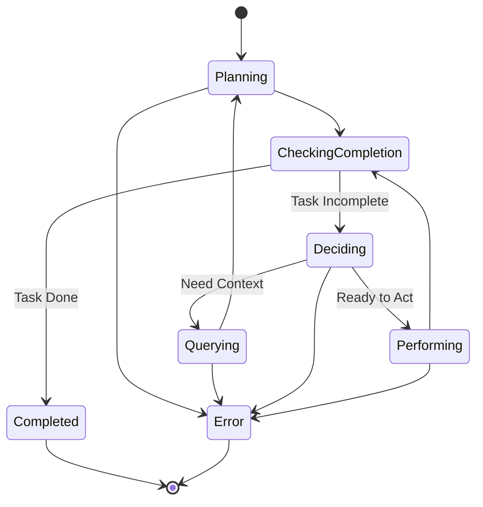

# Agent Control Flow

See [ARCHITECTURE.md](ARCHITECTURE.md) for the harness control flow diagram.

## Rules for every agent and developer

- Lower the `target:` value in `codecov.yml`. The guard rejects decreases; admin bypass is the only path.
- Add entries to `ignore:` in `codecov.yml`. The guard counts entries (block- and flow-style) and rejects growth.
- Replace a numeric `target:` with `auto` or remove it. The guard rejects loss of a numeric floor.
- Edit, rename, or delete `.github/workflows/codecov-guard.yml`, `.github/CODEOWNERS`, or other files in `.github/workflows/**` to circumvent the codecov guard.

## Rules for tasks run by Nanna

These bind the Nanna executable's runtime subagents. This section does not restrict developers or coding assistants (Claude Code and similar) working on Nanna's own source.

- Write Nanna's own configuration. A task run by Nanna cannot write the paths in `harness::protected::PROTECTED_PATTERNS` (matched case-insensitively), `.nanna/**`, `**/.nanna/**` and `.git/**`, or Nanna's own configuration directory (`$NANNA_CONFIG_DIR`, else `$XDG_CONFIG_HOME/nanna`, else `~/.config/nanna`), so that a subagent can never create or widen another subagent's permissions. `.git/**` is included because a write to `.git/config` could redirect `origin` and the credentials sent to it. `write_file`, the dev container's read-only mounts, patch extraction, `git_commit` and `git_push_branch` enforce it. That is the whole blocklist: source, tests, scripts, CI workflows, docs and build files are ordinary files, reviewed by a human in the pull request.
- Mark a Nanna pull request ready for review in a repository that sets `human_gate = "solo"`. `.nanna/policy.toml` takes one key, `human_gate = "github"` (the default) or `"solo"`. With no file, or `"github"`, nothing changes: Nanna opens draft pull requests, `github_pr_promote` may mark an owned draft ready, and GitHub review and branch protection decide, which is the gate for an organisation with more than one person. With `"solo"` (one human owns the repository) `github_pr_promote` always refuses, and `git_push_branch` refuses to push a branch whose open pull request is no longer a draft, or whose state it cannot read (a GitHub error, a non-GitHub `origin` and a missing client all refuse). The human's click on Ready for review is then the only thing that makes a Nanna pull request ready, and the agent cannot add commits after that click; further work goes on a new draft. A repository needs nothing beyond adding the file, and no GitHub feature is required, but the harness process needs a `GITHUB_TOKEN` with pull request read access: without one every push in a solo repository refuses (safe, but surprising). A checkout without the file has no gate and nothing warns about it. The file is read from the base checkout on the host before the task's worktree is created, and must satisfy these rules: at most 65536 bytes, unknown keys and an unknown `human_gate` value are errors, and an unreadable, non-UTF-8, malformed, directory or symlink file makes the task refuse to start (a missing file means `github`). The policy reaches task start (plain and container), `TaskWorkspace`, the checkout registry used by the CLI and the eval runner, and the registries that build `github_pr_promote` and `git_push_branch`. Limits: a human click between the draft check and the push is not detected; the lookup reads the pull requests whose head is `{owner}:{branch}` in the repository named by `origin`, so an `origin` that is a fork (the upstream pull request is not seen) is not covered; only open pull requests count, so an agent can close a readied pull request, push and open a new draft; the lookup follows at most 5 pages (500 pull requests) and refuses beyond that; an agent holding a raw GitHub token, a pull request created outside the harness, a workflow the repository allow-lists in `.nanna/deploy.toml` for `ci_trigger` and a merge bot that acts on comments are out of scope; `github_pr_promote` is the only harness code path that calls the un-draft API. `harness/tests/solo_gate_structural.rs` fails when a tool, a `GithubClient` method, a caller of the un-drafting method, a dangerous GraphQL or REST literal or an allow-listed `gh` subcommand appears without a classification, and it enumerates the shell forms (`gh pr ready`, `gh pr merge`, `gh api graphql`, REST `PATCH`, `curl`, `git push`) that the action auditor refuses. Only `harness/src` is scanned, not `nanna-effects`, `image-builder` or the model crates. Its blind spots: contents of `include_str!`, `include!` and `include_bytes!` files, tools written outside the `impl Tool for` syntax, needles assembled at run time, an empty or unreachable solo check (the pin recognises identifiers, not control flow), a tool classified as harmless that is not, the bodies of the two definitions of `mark_pull_request_ready` (`ReqwestGithubClient` and the `GithubClient` trait declaration), which are exempt as a whole so a call to another client's un-draft method nested inside them is not seen (the method is reachable only through the gated promote tool), and shell forms that are not in its list.
- Strip or forge the identity marker. Agent commits end with the `Nanna-Identity: <name>` trailer and agent PR bodies carry `<!-- Nanna-Identity: <name> -->` (`harness::marker`).

## Auditor false-allow eval: what is enforced where

`nanna auditor eval` measures the spawn auditor's model-only false-allow count on the held-out cases and exits non-zero above the threshold (default 0) or when the run cannot be trusted. It is manual today. CI checks only its logic against mocks; no required check measures a real model. A `workflow_dispatch`-only job (`.github/workflows/auditor-eval.yml`) is not a required check and is dispatch-only until the gate can complete on the runner (see #1000); the first measurement is pending, and no held-out false-allow number exists yet. Full description: [docs/agent-evaluation-patterns.md](docs/agent-evaluation-patterns.md#auditor-false-allow-eval-what-is-enforced-where).

## Action audit telemetry: what is exported and what blocks

Every decision of `ActionGate::run_gate` (allow, block, escalate, including the block an auditor error or a log-write failure becomes) is handed to the gate's `ActionAuditSink` exactly once, as an `ActionAuditEvent` that carries only the verdict, reason-code names, identity, tool, task id, effect class and auditor name (names reduced to plain characters and 64 characters; never the tool arguments or reason text). `nanna mcp-serve` and `nanna delegate` attach a `TelemetrySink`, so decisions reach the telemetry system as a counter and an event; `mcp-serve` flushes every 30 seconds and once more on shutdown (stdin closing, SIGINT or SIGTERM) to `telemetry.jsonl` beside the queue, and `delegate` flushes once when its task ends, whether it succeeded or failed, to `telemetry-delegate.jsonl` (the two commands use different files; two `mcp-serve` processes or two `delegate` runs on one queue directory still share a file, where lines are never torn but a rotation can overshoot the cap or drop the other process's `.1`); the file is opened without following symlinks and without blocking, must be a regular file (a symlink or FIFO is refused and logged), is created with mode 0600 and tightened to 0600 if it already existed, and is rotated at 8 MiB to a `.1` sibling, checked per line. The final flush runs on a blocking thread with a 5 second limit, and the process then leaves the runtime within 2 seconds (`Runtime::shutdown_timeout`) even if a blocking task is stuck, such as a hung export or the blocking stdin read of `mcp-serve`, so a signal ends `mcp-serve` while stdin stays open; a hard-hung syscall can still delay exit by up to that 2 seconds. tokio keeps its signal handler installed, so a second SIGINT or SIGTERM during the flush is swallowed rather than killing the process. A panic in the work skips the final flush, and `delegate` has no signal handler, so an interrupted `delegate` loses its telemetry. The exported verdict is the decision `run_gate` returned, not the final registry outcome: `apply_denial_policy` can still turn a task's third denial into an escalation after the gate, and the fail-closed block a registry returns when no auditor is configured never reaches the gate, so neither is exported. Emission is infallible and never blocks or downgrades an action: the durable `ActionAuditLog` remains the fail-closed record (a write failure still turns an Allow into a Block), and telemetry is a derived view. A gate with no sink attached emits nothing; gates built by `nanna agent` and `nanna chat` do not exist (those registries are ungated) and the `TaskManager` default gate used in tests has no sink. `harness/tests/action_audit_structural.rs` pins that `run_gate` is `decide`, `emit`, return the emitted value, and that both CLI gates get the sink from the manager they run (the manager is bound once and handed to the server, the flushed work is the serving or delegate future, the file constant is the command's own). The pin is syntactic: it reads `harness/src` only and matches the adjacent tokens `ActionGate` `new` (so `<ActionGate as Default>::default()` or `ActionGate::from` would not be flagged; `ActionGate` has neither today). The telemetry buffers are bounded (10,000 metrics and 10,000 events; the oldest tenth is dropped and counted in `nanna_telemetry_dropped_total`). Not exported: a prompt hash (the action verdict does not carry one). Budget counters: `CostAccountant` takes the same `TelemetrySystem` through `set_telemetry` (first attachment wins; `nanna mcp-serve` and `nanna delegate` attach it from `manager.cost_accountant()` beside the gate sink, so the same flush and file carry both). After every `charge_count_within`, `record_minutes` and `record_minutes_sync`, whether it succeeded, was denied or failed, the accountant emits the gauges `nanna_budget_spent`, `nanna_budget_limit` and `nanna_budget_remaining` (limit and remaining only for a dimension that has a limit; remaining never below 0) with exactly the labels `identity` (reduced to plain characters, 64 characters), `class` (`ci` or `sandbox`), `scope` (`task` or `day`) and `kind` (`count` or `minutes`). No task id, repo or free text is a label; the `task` scope gauge reports whichever task of that identity was charged last. Emission is infallible and runs after the decision is made, so it cannot change it. The structural pin requires each of those three methods to be `decide`, `emit`, return the decided value, and requires `main.rs` to call `export_budget(&<manager>.cost_accountant(), &<telemetry>)` in both commands; it is syntactic. Not exported: the repo scope, `claim_run`, `note_run`, the fail-closed accountants inside `ci_tools` and `sandbox_tools` (no telemetry attached), `nanna agent` and `nanna chat`, and the `TaskResult` snapshot at task end (`task.rs` is untouched).

## The pull request a task deploys: where the binding comes from

A dispatched task has no pull request until it opens one. The only writer of the binding is `github_pr_open`: after the host created the draft pull request it records the origin-resolved repository, the number from the host's response, the branch and the `git rev-parse HEAD` the harness ran (`harness/src/pr_binding.rs`; first binding wins, nothing can replace it, and its `bind` is crate-private, so no tool argument, queue field or MCP argument can set it). The registry owns the cell; `review_action` offers the bound number to the lease context only when the bound repository equals the subject's repository after normalisation (ASCII `owner/name`, case-insensitive; a trailing dot makes a different name, and a non-ASCII lookalike, extra path parts or an empty part cannot be normalised and match nothing), and `sandbox_deploy` refuses unless the same check holds against the repository it resolves from `origin`, so the lease key and the deployed repository cannot disagree. A Sandbox lease is keyed by the normalised repository, so `O/N` and `o/n` hold one lease. Branch and deploy lease keys keep the raw spelling, so a Sandbox-class paths lease and a Repository-class paths lease on the same upper-case repository no longer collide when `subject.paths` is non-empty (#1046). A host-set `ActionSubject.pr` and the binding must agree: when both exist and differ the gate offers no number and refuses, so the lease can never name one pull request while the tool deploys another. An empty or mismatching binding fails closed at the gate and at the tool. Known limits: a pull request that GitHub created while the client call errored is never bound (#1044); a fork checkout whose `origin` differs from the subject's repository is refused; `workspace.sandbox_pr` / `set_sandbox_pr` / `bind_sandbox_pr` are dead plumbing kept only because `task.rs` and a `task.rs` test still call them (#1045, needs `task.rs`). The result of `sandbox_deploy` reports `pr_number` and `head_sha`; the head sha is recorded and reported, not enforced against `image_tag`. A closed or merged bound pull request does not block a deploy (#1035). A host-supplied binding for a task dispatched against an existing pull request is not part of this design (#1037). `harness/tests/pr_binding_structural.rs` pins the single writer and the single reader (callers are keyed by impl type and function, so a `bind` inside another tool's `execute` is caught), and that `QueuedTask`, `ActionSubject`, `SandboxContext` and the `assign_task` / `plan_task` arguments gain no pull request or window input.

## When 100% patch coverage is genuinely unhittable

1. If you are blocked because of disabled tests, enable them.
2. If you are blocked because your architectural decisions yield untestable code, re-architect.
3. If a CI-environment failure you cannot fix is blocking your tests, escalate by opening a GitHub issue describing the exact missing-test problem.

# Agent State Machine

