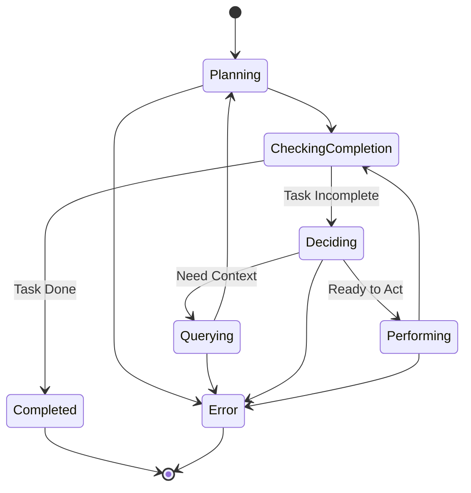

# Agent Control Flow

See [ARCHITECTURE.md](ARCHITECTURE.md) for the harness control flow diagram.

## What an agent should NOT do

- Lower the `target:` value in `codecov.yml`. The guard rejects decreases; admin bypass is the only path.
- Add entries to `ignore:` in `codecov.yml`. The guard counts entries (block- and flow-style) and rejects growth.
- Replace a numeric `target:` with `auto` or remove it. The guard rejects loss of a numeric floor.
- Edit, rename, or delete `.github/workflows/codecov-guard.yml`, `.github/CODEOWNERS`, or other files in `.github/workflows/**` to circumvent the guard.
- Write to a **protected path**. Nanna cannot modify its own configuration. The set (`harness::protected::PROTECTED_PATTERNS`, matched case-insensitively) is `.nanna/**` (agent identities, `deploy.toml`, availability windows), `**/.nanna/**` (any nested `.nanna/` directory), `.git/**`, `.github/workflows/**`, `.github/CODEOWNERS`, `CODEOWNERS`, `docs/CODEOWNERS`, `codecov.yml`, `windows.toml`, `tarpaulin.toml`, `deny.toml`, `flake.nix`, `flake.lock`, `.github/rulesets/**`, `.githooks/**`, `.cargo/**`, `.devcontainer/**`, `AGENTS.md`, `.gitattributes`, `.gitmodules`, `evals/cases/**`, `harness/src/protected.rs`, `harness/src/scope.rs`, `harness/src/auditor/**`, `.github/**` (every file under `.github`, including actions and `dependabot.yml`), `.cargo-husky/**`, `.envrc`, `.config/**`, `.claude/**`, `nix/**`, `CLAUDE.md`, `docs/ci/protected-paths-guard.yml`, `harness/src/workspace.rs`, `harness/src/tools.rs`, `harness/src/marker.rs`, `harness/src/identity/**`, `harness/src/action_auditor/**`, `harness/src/windows.rs`, `harness/src/capabilities.rs`, `harness/src/container.rs`, `harness/src/harness_adapter/isolation.rs`, `harness/src/harness_adapter/checked.rs`, `scripts/**`, `tests/security/**`, `tests/lib/**`, `tests/run-all-tests.sh`, `harness/dev-container.toml`, `harness/src/rollout/executor.rs`, `harness/src/rollout/hooks.rs`, `harness/src/rollout/serverless.rs`, `harness/src/rollout/state.rs`, `harness/src/effects.rs`, `harness/src/leases/**`, `auto-issue-pr.sh`, `test-agentic-security.sh`, `harness/src/pr_tools.rs`, `docs/pr-lifecycle-tools.md`, `harness/src/budget.rs`, `harness/src/ci_tools.rs`, `harness/src/ci_policy.rs`, `harness/src/ci_integrity.rs`, `harness/src/deploy/template.rs`, plus Nanna's own configuration directory (`$NANNA_CONFIG_DIR`, else `$XDG_CONFIG_HOME/nanna`, else `~/.config/nanna`). No identity scope widens it: `write_file` refuses these paths, the dev container mounts them read-only and never mounts the configuration directory, and `extract_changes` / `format_patch` refuse to produce a patch that touches them (the task fails with `error_type = "ProtectedPathViolation"` and the auditor is notified).
- Rely on the protected set for more than it does. Deliberately NOT protected, each with its true reason: the `Cargo.toml` / `Cargo.lock` files (the set is fixed for every repository Nanna works on and agents must be able to add dependencies; the only control today is ordinary human PR review, because CODEOWNERS does not list them, `deny.toml` sets `unknown-git` and `unknown-registry` to `warn`, and CI skips `cargo audit` and `cargo deny` on Linux: #925); `harness/src/main.rs` (the CLI entry point; it delegates to protected modules); `harness/src/lib.rs` (module declarations only); `harness/src/scheduler/policy.rs` (it orders queued entries and picks a slot, and grants no effect or scope); `harness/src/task.rs` (it turns a protected-path violation into a failed task and drops the patch, so editing it can neutralise the protection; left editable only because other work is in progress there: #927); the rest of `harness/src/rollout/**` and `harness/src/deploy/**` other than `harness/src/deploy/template.rs`, which is protected because it enforces the CI allowlist at load (they feed the protected rollout executor evidence and configuration, and `deploy/validate.rs` validates the human-authored `.nanna/deploy.toml`; editable for now: #926); `harness/src/harness_adapter/{mod,pi,pi_extension}.rs`, `harness/src/mcp/**` and `harness/src/escalation/**` (they build `LaunchPlan`s, call the protected gates, and hold the human-only `ResolveGrant`; the isolation policy checks a plan's shape only and the argv, stdin and file contents are pinned by agent-editable tests: #928); `nanna-effects/**` (the `touches!` declaration collector: it informs blast-radius review and grants nothing); `.gitignore` (an ignore rule cannot hide a change to a tracked protected file, and ignored files never enter a patch or a PR); and `tests/integration/**` and `tests/cachix_integration_test.sh` (ordinary tests; the security suites, their helpers and the runner that selects them are protected). Protected files that are absent from a repository are created as empty read-only placeholders in the container worktree (invisible to git, but a tool that auto-detects `flake.nix`, `flake.lock`, `.envrc` or `deny.toml` sees an empty file). Known gaps, tracked under #639: a hardlink to a protected file writes through to it because only path strings are compared (#917); on Windows a trailing dot or space and 8.3 short names address a protected file without matching its pattern (#918); on macOS NFC and NFD spellings of a non-ASCII name are not folded (#919); a nested `**/.nanna/**` directory has no mount root, so a shell write there is caught only at patch extraction (#810); `.git/**` is missing from the container join (#802); no `AuditHook` notifies the auditor of a violation (#866); the guard workflow is not installed (#862); it keys on the `Nanna-Identity` marker and `PR_AUTHOR`, not on the branch, and the marker is agent-controlled, so a PR without a marker is treated as human (#755); and no code stamps the trailer yet (#740).
- Expect protected files to need a human. In Nanna's own repository agents can no longer edit `tools.rs`, `workspace.rs`, `identity/**`, `action_auditor/**`, `container.rs`, `effects.rs`, `leases/**`, `rollout/executor.rs`, `nix/**`, `scripts/**`, `.github/**`, `.claude/**` and the rest of the set; those changes need a human-authored PR. Once the guard is installed (#862) `PROTECTED_PATTERNS_HUMAN_AUTHORS` must list every login allowed to change them, including any Dependabot bot login, or the guard fails Dependabot PRs that touch `.github`.
- Strip or forge the identity marker. Agent commits end with the `Nanna-Identity: <name>` trailer and agent PR bodies carry `<!-- Nanna-Identity: <name> -->` (`harness::marker`); the CI guard uses it to tell agent PRs from human PRs.
- Circumvent the protected-paths guard. Its workflow is maintained at [`docs/ci/protected-paths-guard.yml`](docs/ci/protected-paths-guard.yml) and must be installed into `.github/workflows/` by a maintainer, because agents cannot write there; it fails any PR carrying an identity marker that touches a protected path.

## When 100% patch coverage is genuinely unhittable

1. If you are blocked because of disabled tests, enable them.
2. If you are blocked because your architectural decisions yield untestable code, re-architect.
3. If a CI-environment failure you cannot fix is blocking your tests, escalate by opening a GitHub issue describing the exact missing-test problem.

# Agent State Machine

